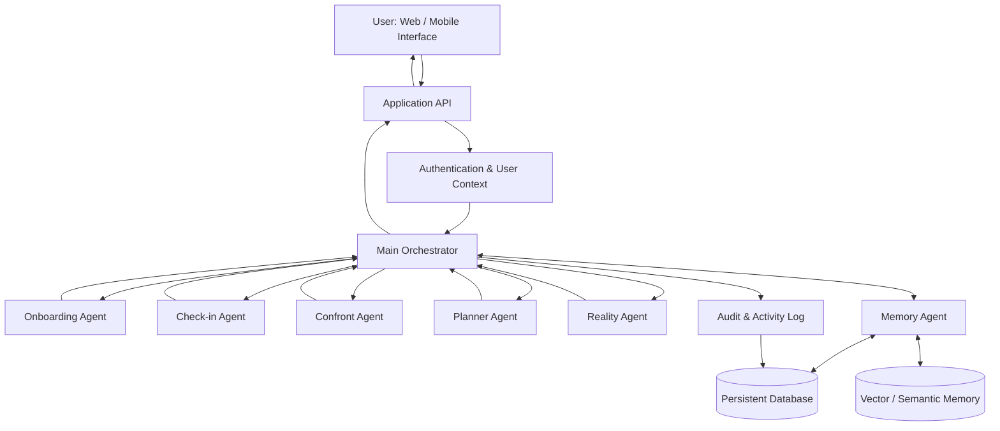
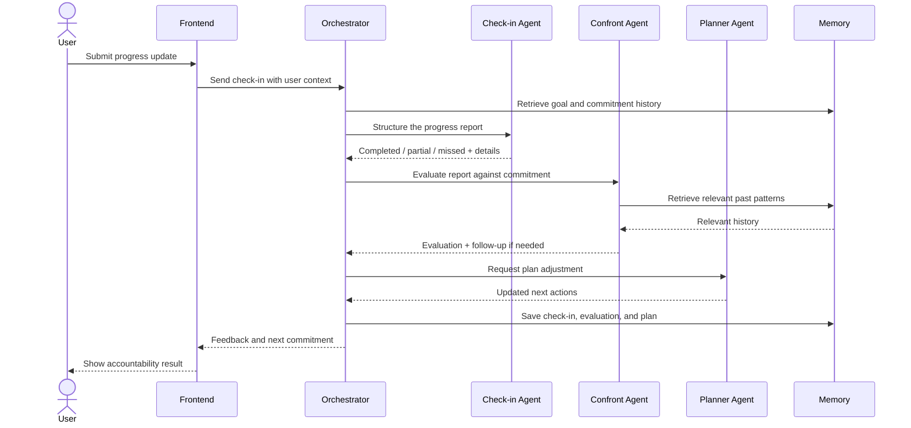

# BRUTALITY AI
### Stop Lying to Yourself. Start Delivering.

> An AI-powered personal accountability system that remembers what you committed to, tracks what you actually did, and challenges the gap between the two.

## 1. Overview

BRUTALITY AI is a multi-agent personal accountability platform for people who have meaningful goals but struggle to execute consistently.

Most people already know what they should do: study, exercise, learn a skill, build a product, or complete a project. The difficult part is following through day after day. Conventional productivity tools are good at storing intentions, reminders, and task lists, but they rarely examine why a commitment was missed or challenge a repeated pattern of avoidance.

BRUTALITY AI is designed around a persistent accountability loop:

**Goal → Measurable Commitment → Daily Check-in → Honest Evaluation → Plan Adjustment → Reality Report → Repeat**

It is not intended to be another generic chatbot or task-list application. Its central purpose is to help users make specific commitments, report honestly, recognize patterns, and make realistic improvements.

## 2. The Problem We Are Solving

### Core problem statement

**People know what they need to do, but without consistent accountability, intentions often fail to become action.**

This problem affects students, working professionals, founders, creators, fitness-oriented people, and anyone trying to build consistency.

### Why existing approaches fall short

1. **To-do apps record intentions.** They can show what a person planned to do, but usually do not meaningfully challenge the difference between a promise and its outcome.
2. **Reminders are easy to dismiss.** A notification can prompt action, but it cannot by itself understand recurring avoidance or help a user examine it.
3. **Generic AI can be overly agreeable.** Encouragement is useful, but encouragement alone may not identify vague explanations, contradictions, or repeated missed commitments.
4. **Human accountability is difficult to sustain.** Friends, family, mentors, and peers may be unavailable, inconsistent, or unsure how firmly to challenge someone.
5. **Excuses can become patterns.** Without a record of previous commitments and check-ins, users can repeatedly rationalize the same behaviour without seeing the pattern.

The underlying issue is not simply a lack of information. It is the gap between knowing, committing, and consistently acting.

## 3. Our Solution

BRUTALITY AI provides a structured accountability system supported by specialized AI agents and persistent user context.

The system:
- Converts broad goals into measurable commitments.
- Collects regular progress updates.
- Evaluates whether an update addresses the commitment clearly.
- Identifies vague explanations, inconsistencies, and recurring avoidance patterns.
- Asks for clarification or evidence when appropriate to the task.
- Adjusts future plans based on actual progress and constraints.
- Produces periodic reports that show what happened, what patterns emerged, and what should change next.

### What “brutality” means in this product

Brutality means **honesty, clarity, and consistency—not abuse**. The system should challenge an excuse or an unsupported claim without insulting, humiliating, threatening, or applying unsafe pressure to the user. It should distinguish a genuine obstacle from avoidant behaviour and support realistic recovery after a missed commitment.

## 4. Target Users and Use Cases

| User group | Example accountability use case |
|---|---|
| Students | Study hours, revision targets, assignments, exam preparation |
| Working professionals | Skill development, deep-work sessions, project milestones |
| Founders | Product milestones, customer discovery, execution priorities |
| Creators | Publishing schedules, content production, creative practice |
| Fitness-oriented users | Training consistency, recovery-aware routines, nutrition habits |

Users should be able to define their own goals and choose commitments appropriate to their circumstances.

## 5. Core Features

### Goal onboarding
- Capture the user's goal, motivation, timeframe, and constraints.
- Break a broad goal into measurable outcomes.
- Define daily or weekly commitments.
- Establish completion criteria and a check-in schedule.

### Daily check-ins
- Ask what the user committed to do.
- Capture completed, partially completed, and missed work.
- Record blockers and relevant context.
- Keep a chronological history of check-ins.

### Honest evaluation and confrontation
- Compare the user's update with the original commitment.
- Identify missing details, vague claims, and inconsistencies.
- Ask focused follow-up questions when the report is unclear.
- Request evidence only when it is relevant, proportionate, and suitable for the task.
- Provide direct but respectful feedback.

### Adaptive planning
- Use actual performance and user constraints to update the next plan.
- Break unrealistic tasks into smaller actions.
- Preserve meaningful deadlines where possible.
- Avoid automatically extending deadlines simply because a task was missed.
- Explain why a plan was changed.

### Weekly Reality Report
A concise report can include:
- Commitments planned, completed, partially completed, and missed.
- Consistency and completion trends.
- Repeated blockers or excuse patterns.
- Progress toward longer-term goals.
- What worked and what did not.
- A practical plan for the next period.

### Persistent memory
- Retain goals, commitments, check-ins, decisions, and relevant patterns.
- Retrieve only context relevant to the current accountability decision.
- Keep each user's information isolated from other users.
- Allow users to inspect, correct, and delete their data.

## 6. Multi-Agent Architecture

BRUTALITY AI uses specialized agents coordinated by a central orchestrator. Each agent has a focused responsibility rather than asking one general-purpose agent to handle the entire workflow.

### Agent responsibilities

| Component | Responsibility |
|---|---|
| Main Orchestrator | Routes requests, coordinates agents, maintains workflow state, and handles errors |
| Onboarding Agent | Understands goals and turns them into measurable commitments |
| Check-in Agent | Collects progress updates and structures the user's report |
| Confront Agent | Compares reports with commitments and identifies vagueness, contradictions, or avoidance |
| Planner Agent | Updates the plan using evaluation results, progress, and constraints |
| Reality Agent | Produces weekly summaries, trends, and next-period recommendations |
| Memory Agent | Stores and retrieves user-specific goals, commitments, check-ins, and history |

### Architecture diagram



*This is the proposed logical architecture. The exact deployment and storage technology should match the implementation in the repository.*

### Daily accountability sequence



## 7. Data and Memory Model

A production implementation should maintain structured records in addition to semantic memory.

Suggested core entities:

- **User:** identity, preferences, timezone, consent, and account settings.
- **Goal:** title, description, motivation, start date, target date, and status.
- **Commitment:** measurable action, frequency, due time, and completion criteria.
- **Check-in:** date, user update, completion state, blockers, and optional evidence reference.
- **Evaluation:** agent assessment, clarity, consistency, follow-up questions, and rationale.
- **Plan Version:** planned actions, changes, and reasons for each change.
- **Reality Report:** reporting period, metrics, patterns, observations, and next steps.
- **Memory Record:** user-scoped contextual information with source and timestamp.

Use a stable user ID and database constraints to prevent cross-user data access. Store timestamps in a consistent format and display them in the user's timezone.

## 8. Suggested Technology Architecture

The final stack must be confirmed against the actual repository. A practical implementation could use:

| Layer | Suggested technology |
|---|---|
| Frontend | React with Vite |
| UI and motion | CSS / Tailwind, Framer Motion, Lucide icons |
| Backend | Python application and API layer |
| Agent orchestration | Python-based orchestrator with clearly defined agent interfaces |
| Language model | Configurable LLM provider behind a service abstraction |
| Structured persistence | PostgreSQL or SQLite for an early local MVP |
| Semantic memory | ChromaDB or another vector store, configured for persistence |
| Authentication | Secure session or token-based authentication |
| Charts and reports | Recharts or equivalent |
| Deployment | Frontend and backend deployed independently |

Do not treat this table as a claim that every component is already implemented. It is a recommended target architecture.

## 9. User Experience

A typical user journey:

1. The user creates an account and defines a goal.
2. The Onboarding Agent converts it into measurable commitments.
3. The user receives a clear daily plan.
4. The user checks in and reports progress.
5. The Check-in Agent structures the update.
6. The Confront Agent evaluates it against the commitment and relevant history.
7. If the update is unclear, the system asks a focused follow-up question.
8. The Planner Agent proposes realistic next actions.
9. The Memory Agent saves the interaction.
10. The Reality Agent generates a weekly report.

## 10. Safety, Privacy, and Responsible Behaviour

Accountability must not become harassment or coercion.

- Use direct, respectful language; never shame, threaten, or insult users.
- Do not encourage sleep deprivation, overtraining, starvation, self-harm, or other unsafe behaviour.
- Recognize illness, disability, emergencies, caregiving, and other legitimate constraints.
- Do not infer dishonesty solely because a user missed a commitment.
- Request evidence only when appropriate; never demand invasive or sensitive proof.
- Make it clear when an AI assessment is uncertain.
- Protect personal data with authentication, authorization, encryption in transit, and user-level data isolation.
- Provide data export and deletion controls.
- Do not use private user data to train or share models without clear consent.

## 11. Evaluation and Success Metrics

The product should be evaluated on meaningful outcomes, not simply chat volume.

Potential metrics:
- Commitment completion rate over time.
- Check-in consistency.
- Percentage of vague updates clarified through follow-up.
- Plan changes accepted and completed.
- Reduction in repeated missed commitments.
- User-reported usefulness and fairness of feedback.
- Accuracy and usefulness of Reality Reports.
- False-positive rate for identifying excuses or inconsistencies.

Avoid claiming that the system improves goal achievement until this has been tested with users and measured.

## 12. MVP Scope and Development Roadmap

### MVP
- Goal creation and measurable commitments.
- Daily check-in flow.
- Commitment-versus-progress evaluation.
- Direct, respectful confrontation and clarification.
- Plan adjustment.
- Persistent user-specific history.
- Weekly Reality Report.
- Basic dashboard and goal/report views.

### Next iterations
- Calendar integration and timezone-aware reminders.
- Optional task-specific evidence uploads.
- More detailed trend analysis.
- User-controlled accountability intensity.
- Exportable reports.
- Mobile-first experience and notifications.

## 13. Repository Structure (Suggested)

```text
brutality-ai/
├── frontend/
│   ├── src/
│   │   ├── components/
│   │   ├── pages/
│   │   ├── features/
│   │   ├── services/
│   │   └── styles/
│   └── package.json
├── backend/
│   ├── app/
│   │   ├── agents/
│   │   │   ├── onboarding.py
│   │   │   ├── checkin.py
│   │   │   ├── confront.py
│   │   │   ├── planner.py
│   │   │   ├── reality.py
│   │   │   └── memory.py
│   │   ├── orchestration/
│   │   ├── api/
│   │   ├── models/
│   │   ├── services/
│   │   └── main.py
│   ├── tests/
│   └── requirements.txt
├── docs/
│   ├── architecture.md
│   └── project-description.md
├── .env.example
├── .gitignore
└── README.md
```

This is a suggested organization, not a statement about the current repository layout.

## 14. Running the Project

The exact commands depend on the repository's current setup. Once dependencies and entry points are confirmed, document them here. A typical local setup will require:

1. Clone the repository.
2. Install frontend and backend dependencies separately.
3. Copy `.env.example` to `.env`.
4. Add required model-provider credentials locally.
5. Configure the database and persistent memory location.
6. Start the backend API.
7. Start the frontend development server.
8. Open the local frontend URL.

Never commit `.env`, API keys, access tokens, private user data, or production credentials.

## 15. Project Positioning

**BRUTALITY AI is an AI-powered accountability system that turns goals into measurable commitments, checks progress against those commitments, challenges vague excuses, adapts the plan, and reports the truth over time.**

It aims to move users beyond simply planning what they want to do and toward consistently examining what they actually deliver.

---

**Tagline:** Stop Lying to Yourself. Start Delivering.
